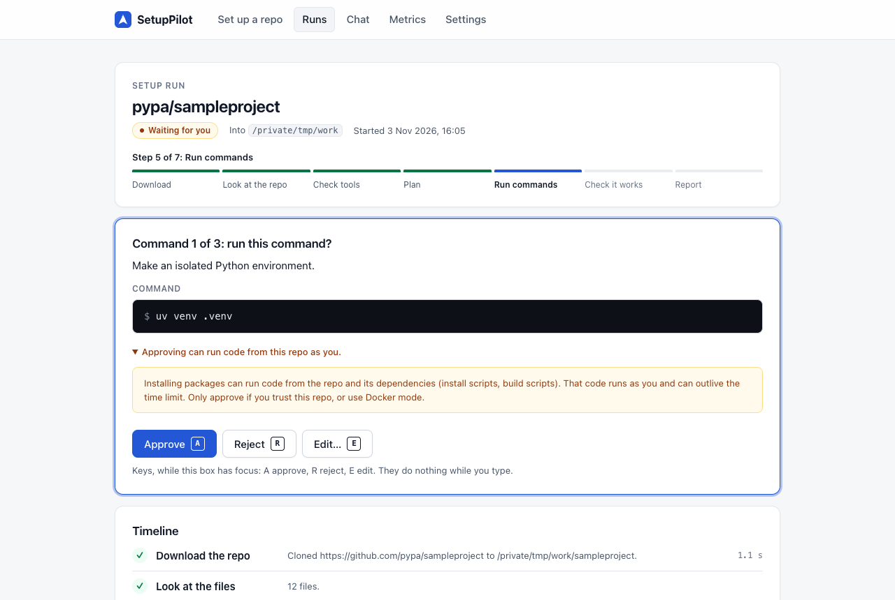
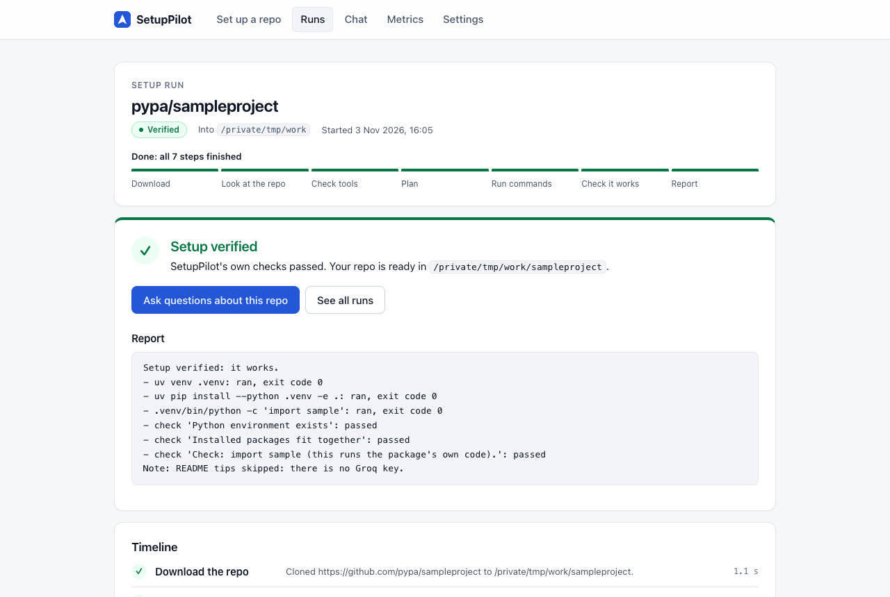
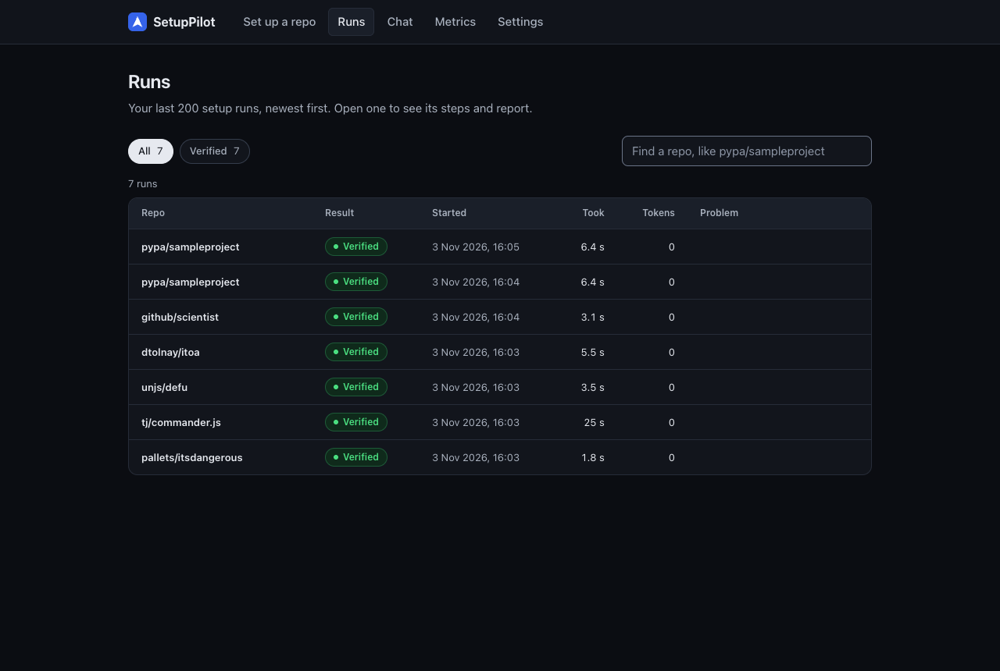

# SetupPilot

[](https://github.com/Kapurrrishabh/setup-pilot/actions/workflows/ci.yml)

[](LICENSE)

An AI agent that sets up a GitHub repo on your machine and asks you before every command, plus
a chatbot that answers questions about the repo from its own files.

| Approve each command | See that it really works |
|---|---|
|  |  |

## Problem

Setting up an unknown open-source repo wastes the first hour: old READMEs, guessing the
package manager, missing tools, and install errors. Running install commands from an unknown
repo is also risky, because install scripts can run any code.

## Goals

- **Setup agent:** give a GitHub URL (or pick one of your repos after you sign in with GitHub)
  and a folder. SetupPilot reads the repo, finds the stack, checks the tools you need and offers
  to install a missing one, makes an isolated environment, installs dependencies and checks that
  the setup really works. Every command that changes your machine needs your approval first.
- **Repo chatbot:** ask questions about a repo (what it does, how its code works, layout, how to
  run it, license). It answers only from the repo's own files, with file and line sources.
- **Windows first**, and the same on macOS and Linux.
- Free to run: Groq free tier, Supabase free Postgres, local embeddings, your own GitHub App.

## Out of scope

- Any host other than `https://github.com/<owner>/<repo>`. Private repos only through your own
  GitHub App (see [Sign in with GitHub](#sign-in-with-github-optional)).
- Writing or fixing code. The chatbot answers questions about the repo only.
- Paid APIs or other LLM providers.
- Running any command without your approval.

## Quick start

You need git and [uv](https://docs.astral.sh/uv/getting-started/installation/) (it brings
Python 3.12+). Everything else is free.

**Windows 10 or 11 (x64), in PowerShell.** Install git and uv with winget, then open a new
PowerShell window so both are found:

```powershell
winget install --id Git.Git -e
winget install --id astral-sh.uv -e
```

```powershell
git clone https://github.com/Kapurrrishabh/setup-pilot.git setuppilot; cd setuppilot
uv sync                    # installs everything, about 1 GB (PyTorch for the chatbot's embeddings)
copy .env.example .env     # then add your free Groq key, and your Supabase URL (see Database)
uv run setuppilot db-check # optional: checks the database and makes the tables
uv run setuppilot web      # open http://127.0.0.1:5005
```

**macOS and Linux.** Install git and uv your usual way (for example `brew install git uv`), then:

```bash
git clone https://github.com/Kapurrrishabh/setup-pilot.git setuppilot && cd setuppilot
uv sync
cp .env.example .env
uv run setuppilot db-check
uv run setuppilot web
```

Check that it works: `.\test.ps1 basics` on Windows or `./test.sh basics` on macOS and Linux
(lint, types and about 1,700 tests; no internet or keys needed; if PowerShell says running
scripts is disabled, run `uv run python scripts/acceptance.py basics` instead), and
`uv run setuppilot ask "What is uv?"` (one real Groq call; prints the answer and tokens used).
Run `uv run setuppilot --version` to see which version you have.

Before real use, copy your Groq limits from https://console.groq.com/settings/limits into
`config.yaml`. The numbers there now are only a starting guess.

More: [security notes](docs/SECURITY.md), [evaluation report](eval/REPORT.md),
[5-minute demo](docs/DEMO.md), [testing still to do](#testing-still-to-do),
[contributing](CONTRIBUTING.md), [changelog](CHANGELOG.md).

## Web app

```bash
uv run setuppilot web      # then open http://127.0.0.1:5005
```

Pages: **Set up a repo** (URL, folder, Docker mode, pre-flight check), the **live run** (a
progress bar, the approve / reject / edit box with keyboard keys A, R and E, the timeline of
steps, Cancel, and a clear verified / not verified result with the next step), **Chat**, **Runs**
(filter by result, search by repo), **Metrics** and **Settings** (tokens used today against the
budget, requests left per model). It follows your system's light or dark theme, works on narrow
windows, works with the keyboard only, and announces new steps and questions to screen readers
(checked with axe; not yet tried with a real screen reader).

Runs work in the background: refreshing or closing the page does not stop them, and a run
waiting for approval is still there after the app restarts (with Supabase connected). A run that
was stopped by a restart shows as **Paused**; open it and press Carry on. Do not drive the same
run from the terminal and the web app at the same time.



The app listens on 127.0.0.1 only and refuses any other host in config.yaml, because it runs
commands on your machine. It also refuses requests from other websites open in your browser.

## Set up a repo

```powershell
mkdir ~/work                             # on macOS and Linux: mkdir -p ~/work
uv run setuppilot run https://github.com/pypa/sampleproject ~/work
uv run setuppilot run <url> ~/work --subdir packages/web   # only this project of a monorepo
uv run setuppilot resume <run id>        # carry on after you stopped with q, or after a restart
uv run setuppilot run <url> ~/work --docker   # install inside a container (needs Docker)
```

The flow: clone, scan, detect the stack from the files, let the AI read the repo, check your tools
(and offer to install a missing one), ask which way to set it up if there are several, plan, then
**ask you before every command** (approve, reject or edit), run it, ask the AI why if it fails,
check that the setup really works, and report. It says "verified" only when SetupPilot's own
checks pass.

- Commands run without a shell, from an allowlist, inside the repo folder, with a time limit.
  They never get your API keys or other secrets.
- Install scripts can still run code from the repo. Use `--docker` for repos you do not trust,
  from the terminal with the web app closed (a container can reach the web app; see
  [docs/SECURITY.md](docs/SECURITY.md)).
- A paused run is saved in Supabase, so it survives a restart. Without a database it is kept
  in memory only.
- Docker mode supports pip, uv, npm, yarn, bun, Go, Cargo, Bundler, Maven, Gradle, .NET,
  Composer and Dart repos (and Compose runs on your machine). Poetry, Pipenv, PDM, conda, pnpm
  and Flutter repos are not supported in Docker mode yet.
- With `--docker`, `.venv` and `node_modules` are built for Linux inside the image. Use them from
  that image, or run again without `--docker` to use them on your machine.
- SetupPilot never deletes anything. After a clone that timed out or was refused for size, or a
  failed install, remove that half-finished folder yourself before a new run into the same place.

### What the AI does, and what it does not do

The AI (Groq's free models) reads and guesses. SetupPilot's own code checks and runs.

- **It reads the repo.** SetupPilot sends it a short summary: manifests, lock file names, the
  README's install sections, CI and Dockerfile lines, and the names (never the values) in
  `.env.example`, with secrets hidden. The AI says which projects the repo has, which tools they
  need and how to set each one up.
- **SetupPilot checks that answer against the files.** Folders and files the AI names must be in
  the repo. If the AI and the lock file disagree on the package manager, both ways are offered,
  the lock file's first. Where SetupPilot has its own plan for a stack, that plan runs, and the
  AI's steps only add to it.
- **Every command it proposes** goes through the same allowlist and your approval as any other.
  One that is not allowed is shown as blocked and never runs. Its copy of a command SetupPilot
  already runs is left out, with a short note only when its version added something.
- **When a command fails,** it guesses why and may propose fixes (see Recovery below).
- **It never says "verified".** Only SetupPilot's own checks can. For a stack SetupPilot has no
  plan for, the AI's plan can run if every step is allowed; the result then says it was checked
  only by the AI's checks.
- **It never runs** the manual steps or the start command it lists. They are shown for you to read.
- **Turn it off** with `agent.use_ai_planning: false` in `config.yaml`. Without a Groq key it is
  off too. Then SetupPilot uses only the files and its own plans, as in 0.1.
- **Cost, measured with real Groq:** a clean run makes 2 calls (the analysis and the report),
  about 3,500 tokens. A run that needed 2 fixes made 5 calls, about 7,200 tokens.

### Missing tools

Before any command, SetupPilot checks the tools the project needs, and their versions where the
files say. A command never runs while a tool it needs is missing.

- **Windows:** it offers to install the tool with winget, one tool and one approval at a time.
  Windows may ask for admin rights, and winget accepts the package's license for you.
- **macOS:** it offers `brew install`.
- **Poetry, PDM and Pipenv** are installed with `uv tool install` on every system.
- An install is offered only when winget, brew or uv is there; otherwise SetupPilot shows how to
  install the tool by hand.
- **Linux:** installs need `sudo`, so SetupPilot shows the command for you to run.
- Docker, conda, Bun, Ruby, Dart and Flutter are always installed by hand; SetupPilot shows how.
- The install command comes from a fixed table in SetupPilot, never from the AI or the repo, and
  it cannot be edited.
- Then ask it to check again. It reads Windows' saved PATH again, so a tool you just installed is
  found without a restart. It asks at most 3 times (`agent.max_install_rounds`).
- A Node, Java, .NET or Ruby version outside the range the project asks for stops the run. Any
  other version difference is a warning.

### Recovery

When a command fails, the AI reads the end of its output and guesses why. The guess is shown as
the AI's guess, which may be wrong.

- It may propose up to 2 fix commands. Each needs your approval, then the failed command runs
  again.
- A command that already failed in this run is never offered again.
- A fix that is not allowed becomes a step for you: SetupPilot shows it and waits until you say
  done (it tries again) or stop.
- At most 2 fixes per step and 3 per run (`agent.max_fixes_per_step`,
  `agent.max_fixes_per_run`). After that, or when you reject a fix or a fix fails, the run stops
  and says why.
- A failed optional step is only reported. A missing tool the AI points to is checked by
  SetupPilot and offered as an install, as above.

### Sub-projects (monorepos)

When a repo holds more than one project (for example `backend/` and `frontend/`), the AI lists
up to 5 and SetupPilot asks which one to set up. The commands then run inside that folder. To set
up one folder only, give it at the start (`--subdir packages/web` in the terminal); the clone then
downloads only the files at the top of the repo and in that folder. Docker mode does not set up
sub-projects yet.

### Docker (for `--docker` and Compose repos)

On macOS, Colima is a free Docker engine:

```bash
brew install colima docker docker-compose docker-buildx
mkdir -p ~/.colima/_lima/_config && cp docs/colima-override.yaml ~/.colima/_lima/_config/override.yaml
colima start
```

- Add `{"cliPluginsExtraDirs": ["/opt/homebrew/lib/docker/cli-plugins"]}` to
  `~/.docker/config.json` so `docker compose` and `docker buildx` are found.
- The override keeps ports that containers publish on this Mac only. Without it, Colima opens them
  to your whole network.
- macOS does not let Colima read Desktop, Documents or Downloads, so a `--docker` run there fails
  with "operation not permitted". Use a folder like `~/work`.
- Stop it with `colima stop` when you are done.

## Sign in with GitHub (optional)

Without signing in, SetupPilot works with any public repo URL. Sign in to pick from your own
repos, private ones included. SetupPilot ships no shared GitHub App, because whoever owns such an
app could reach every user's private repos. You register your own once, for free:

1. Open https://github.com/settings/apps/new (Settings > Developer settings > GitHub Apps >
   New GitHub App).
2. GitHub App name: `SetupPilot-<you>` (unique, at most 34 characters). Homepage URL:
   `https://github.com/Kapurrrishabh/setup-pilot`.
3. Callback URL: leave it empty. Keep **Expire user authorization tokens** ticked. Leave
   **Request user authorization (OAuth) during installation** unticked. Tick **Enable Device
   Flow**. Leave Setup URL empty and **Redirect on update** unticked.
4. Webhook: untick **Active**.
5. Repository permissions: **Contents: Read-only** and **Metadata: Read-only**. Everything else,
   and all organization and account permissions: **No access**.
6. Where can this GitHub App be installed: **Only on this account**. For an organization's
   repos, register the app under that organization.
7. Create the app. Do **not** generate a client secret or a private key; sign-in does not use them.
8. Copy the **Client ID** (not the App ID) and the slug (the end of
   `https://github.com/apps/<slug>`). In `config.yaml`, under `github:`, replace `app: null`
   with this line, using your own values and keeping the two spaces in front:

   ```yaml
     app: {client_id: Iv23liExample, app_slug: setuppilot-yourname}
   ```

9. Install it at `https://github.com/apps/<slug>/installations/new`: your account > **Only select
   repositories** > pick the repos > **Install**.
10. Restart `uv run setuppilot web` and sign in there. GitHub asks for a code: type only the code
    SetupPilot shows you.

What this means:

- **Read only.** The app can read the code and the details of the repos you picked, nothing else.
  SetupPilot never writes to GitHub.
- **Your token** stays in your system's keyring (Windows Credential Manager, macOS Keychain),
  never in a file, the database, logs or the browser. Sign out removes it.
- **Private repo text goes to Groq.** The AI's analysis, fixes and report, and chat questions,
  send parts of the repo's files to Groq. They are also kept in your Supabase database if you use
  one. Do not sign in for code that must not leave your machine.
- Runs and chat repos you reach through the sign-in are shown only in the browser you signed in
  from.
- Sign-in is in the web app only; the terminal commands read public repos.
- More in [docs/SECURITY.md](docs/SECURITY.md#github-sign-in).

## Ask about a repo (chatbot)

```bash
uv run setuppilot index https://github.com/pypa/sampleproject   # read it from GitHub and index it
uv run setuppilot chat pypa/sampleproject                        # ask questions; q to stop
uv run setuppilot eval-chat --mode retrieval                     # score search only, no LLM
uv run setuppilot eval-chat                                      # full score (needs GROQ_API_KEY)
uv run setuppilot eval-chat --mode replay                        # rerun from cached answers, free
```

The chatbot answers questions about a repo (what it does, how its code works, its layout,
setup, config, license, how to contribute) only from the repo's own files. Each answer shows its
sources as file and line ranges, linked to the commit it read. It says "I could not find this in
the repo" when nothing fits, answers "hi" and "thanks" without an LLM call, does not write new
code, and cannot run anything. A short follow-up ("and how do I test that?") is searched together
with the question before it.

It reads whole code files, cut at functions and headings, and searches by meaning and by exact
words (names like `parse_config`) at the same time. Facts from the manifests and CI (versions,
dependencies, scripts) go with every question. Embeddings are made on your machine with
`all-MiniLM-L6-v2` (downloaded once, about 90 MB). Each question costs one LLM call; when nothing
matches by meaning or by word, it answers without one. The evaluation saves after every question,
so if a limit stops it, run the same command later to carry on.

When there is no local clone, SetupPilot reads the repo's files straight from GitHub, without
writing them to disk. A public repo too big for that (`github.max_tarball_mb`) is cloned instead;
a private one is refused. After upgrading from 0.1, index each repo again: the old index had no
line numbers, so it is emptied.

The terminal chat needs a database (`SUPABASE_DB_URL`): without one, the index from
`setuppilot index` is gone when that command ends. Without a database, use the web app's Chat
page, which indexes and answers in one process. If an answer is cut off, raise
`chat.answer_max_tokens` in `config.yaml`.

## History and metrics

```bash
uv run setuppilot runs              # recent runs: status, time, tokens
uv run setuppilot show <run id>     # one run's steps: time, tokens, errors
uv run setuppilot metrics           # success rate, average time and tokens, rate-limit hits, common errors
```

A run's time includes any time it waited for your approval. To send traces to LangSmith (free
tier), set `LANGSMITH_TRACING=true` and `LANGSMITH_API_KEY` in `.env`; it is off otherwise.

## Database (Supabase, free)

1. Make a free project at https://supabase.com.
2. Go to Connect (or Project Settings > Database) and copy the **Session pooler** connection
   string. The direct one needs IPv6, which many home networks do not have. Put it in `.env` as
   `SUPABASE_DB_URL`, with your database password in place of `[YOUR-PASSWORD]`.
3. Run `uv run setuppilot db-check`. The first run creates the tables (with row level security
   on), then it writes one run and reads it back.

Without `SUPABASE_DB_URL` the app still works (except the terminal chat; use the web app's Chat
page). It keeps data in memory only (logs still go to the log file), and it tells you so. If the
database connection breaks with an error in the middle of a run, the run stops with a clear
message; an LLM answer that was already paid for is still used.

For a stricter connection, add `?sslmode=verify-full&sslrootcert=<path>` to `SUPABASE_DB_URL`,
using the CA certificate from Supabase's database settings.

Database tests run against a local Postgres when `TEST_DATABASE_URL` is set. The database name
must end in `_test`, because the tests empty every table. CI starts its own Postgres for this.

## Limits and known problems

- **Groq free tier**: daily limits per model. When they run out, the setup still works (it skips
  the AI's plan, its fixes and the AI summary); the chatbot says "Daily limit reached, try again
  later".
- **Supported stacks**: Python (pip, uv, Poetry, Pipenv, PDM, conda), Node (npm, yarn, pnpm, bun),
  Go, Rust, Ruby, Java (Maven, Gradle), .NET, PHP (Composer), Dart and Flutter, and Docker
  Compose. For another stack the AI's plan can run if every step is on the allowlist; the result
  then says it was checked only by the AI's checks. `make` and `cmake` are never allowed. A repo
  with only a Dockerfile is not set up automatically; it says so.
- **The AI can be wrong**: its plan and its guesses about failures may be off. Every command still
  needs your approval, and only SetupPilot's own checks say "verified".
- **An optional AI step whose program is not installed** stops the run when it runs. Reject it if
  you do not have that program.
- **GitHub's limit without sign-in** is 60 reads an hour from your network. Each public run uses
  2 (the repo and its file list). When they run out, a public whole-repo clone still goes ahead
  and checks its own size instead; a sub-folder clone is refused.
- **Very big repos**: GitHub lists at most 100,000 files of a repo. For bigger repos a sub-folder
  clone is refused; clone the whole repo instead.
- **Windows batch files**: npm, yarn, pnpm and the Maven and Gradle wrappers are `.cmd` or `.bat`
  files on Windows. No quoting is safe for those, so their arguments may only use letters, digits
  and `_ . , : = @ + / \ -`; a command with other characters is refused there.
- **Not tried for real yet**: see [Testing still to do](#testing-still-to-do).
- **Go**: if your network blocks `proxy.golang.org`, run with `GOPROXY=direct` set; SetupPilot
  passes it to Go, also inside Docker mode.
- **Install scripts run code** from the repo and its dependencies. See
  [docs/SECURITY.md](docs/SECURITY.md); use `--docker` for repos you do not trust.
- **The web app** is clicked through in Chrome by `scripts/browser_check.py` (also in CI), and
  was checked with axe (no accessibility problems found) in light and dark, at desktop and
  phone sizes. Firefox, Safari and real screen readers are not tried yet. It is for one person on
  one machine, and has no login (see [docs/SECURITY.md](docs/SECURITY.md)).
- **Slow Groq**: if Groq takes a question but never answers, the chat can wait up to about 4
  minutes (4 tries of up to 30 seconds on each model, plus short waits) before it says Groq is
  busy or not answering.
- **Silent network drops**: if the network to Supabase goes quiet with no error (Wi-Fi drops),
  a database call can wait several minutes, until your computer's network gives up, before the
  run fails. Until then the run page still shows the run as working.
- **Rate limits are counted per process**: each command, and the web app, starts counting
  requests per model from zero, so after a restart or with two commands at once it relies on
  Groq's own "slow down" answer (retry, then the small model, then "Daily limit reached"). The
  daily token budget is read from the database when Supabase is connected, so it holds across
  restarts.
- **Build flags**: a README step like `go build -ldflags "-s -w"` is refused, because `-ldflags`
  can also pick the program that links. Run it yourself if you need it.
- **Budgets** are checked before each call, but two calls at the same moment (a setup run and a
  chat question) can go a little over the daily token budget.
- **Windows on ARM** is not supported: PyTorch and psycopg have no Windows ARM64 wheels in
  `uv.lock`. Use Windows x64.

## Testing still to do

Everything below was built and tested on one MacBook (Apple silicon) with a local Postgres
instead of Supabase, and only a few dozen real Groq calls. CI on GitHub runs lint, types for
Windows, macOS and Linux, all unit tests on Python 3.12 and 3.13 (with a real Postgres and
pgvector), the unit tests on real Windows (without the database), a dependency audit, the package
build, and the Chrome click-through. These checks still need a key, a Supabase project, a GitHub
App or another machine:

| What | Why it is not done yet | How to run it |
|---|---|---|
| Real Groq calls: `ask`, the AI's plan, fixes and report in a run, tokens per run (the setup table's Tokens column; `setuppilot show <run id>` lists each call) | tried on a few repos only | `.\test.ps1 groq setup` |
| The 18-repo setup evaluation with the AI on, and again with `agent.use_ai_planning: false`, on Windows and Linux | not run with v2 yet | `.\test.ps1 setup`, twice |
| Chatbot full answers and "I don't know" (74 questions, target 80%+ grounded) | not run with a key yet | `.\test.ps1 chat` |
| GitHub sign-in: sign in, list your repos, read a private repo, set up one private repo (this also checks that GitHub takes the sign-in as a git password) | needs your own GitHub App | the steps in [Sign in with GitHub](#sign-in-with-github-optional), then set up a private repo |
| Windows: installing a missing tool with winget, then Check again finding it | the Windows CI job does not install anything | on Windows without Node, set up `https://github.com/JedWatson/classnames` |
| Real Supabase: tables, row level security, pause and resume across a restart, cached replay | no Supabase project yet | `.\test.ps1 supabase chat` |
| Windows: Cancel and the time limit stopping every process, `.cmd` tools like npm, Docker Desktop | written from the Windows docs; only the Windows CI job tests it | `.\test.ps1 setup docker browser`, then run a setup and press Cancel while it installs |
| Docker mode and Compose on Docker Desktop, and whether a container can reach the web app | only Colima tried | `.\test.ps1 docker` |
| The web app in Firefox and Safari | only Chrome tried | by hand (steps below) |
| LangSmith tracing (optional) | no LangSmith key | set `LANGSMITH_TRACING=true` and `LANGSMITH_API_KEY` in `.env`, run a setup, look for the trace |

How to run them on Windows, in PowerShell:

```powershell
copy .env.example .env    # add GROQ_API_KEY and SUPABASE_DB_URL (Session pooler string)
.\test.ps1                # every part this machine can run
.\test.ps1 groq chat      # or only some parts: basics groq supabase setup docker chat browser
```

On macOS and Linux, use `cp` and `./test.sh` the same way. Both scripts only run
`uv run python scripts/acceptance.py` with the parts you name, so you can also run that yourself
(for example when PowerShell says running scripts is disabled on this system).

Each part says PASS, FAIL or SKIP (with what it needs). An evaluation only passes if it ran to
the end: one stopped by a limit fails, whatever its scores. Results go to
`test-results/<time>-<machine>/` (the log, the summary and the eval tables); send that folder to
the team. It holds no secrets. Clones go to `setuppilot-test` in your home folder (not Desktop,
Documents or Downloads: Docker cannot read those on macOS, and OneDrive often syncs them on
Windows); delete it when done. The `setup` part needs the stacks' tools (uv, node and npm, pnpm,
bun, poetry, go, cargo, ruby and bundler, java and maven, dotnet, docker); a missing tool shows as
PrereqMissing in the table. The `browser` part needs Google Chrome (or run
`uv run --group e2e playwright install chromium` and set `SETUPPILOT_E2E_BROWSER=chromium`; in
PowerShell, `$env:SETUPPILOT_E2E_BROWSER = "chromium"`); without it, that part is skipped. On
Windows, `basics` runs the tests the way the Windows CI job does, and leaves the coverage gate to
macOS and Linux.

By hand, in Firefox and Safari: open http://127.0.0.1:5005, start a setup of
`https://github.com/pypa/sampleproject`, press Edit and try `rm -rf /` (it must be refused),
approve the rest and check "Setup verified", reload the page (the run must still be there), start
another run and Cancel it, open Runs, Metrics and Settings, and on Chat index the repo and ask
"What license does it use?" (with a key: MIT, with LICENSE.txt as a source). Try it with the
keyboard only, and with a narrow window.

## Future work

- Run the setup evaluation with the AI on and off, and the full chatbot evaluation, with a Groq
  key, and tune the prompts from the results.
- Try sign-in with a real GitHub App, and a signed-in clone.
- Pick Docker-mode images by the repo's version hint.
- Set up Dockerfile-only repos, and sub-projects in Docker mode.
- Offer winget installs for Bun, Ruby, pnpm, PHP, Composer and Dart (their winget IDs are not
  checked yet).
- Index a chat repo again when its newest commit changes.
- Package SetupPilot as a tool you can install with `uv tool install`.
- A login for the web app, so other programs on the same computer cannot use it.

## Layout

- `config.yaml`: models, rate limits, budgets and every other setting. Secrets live in `.env`.
- `src/setuppilot/`: `llm` (Groq, limits, cache), `db` (Supabase/Postgres and memory stores),
  `github` (API client, sign-in, token keyring, reading a repo without a clone), `tools` (URL
  check, clone, scan, detect, prerequisites and installs), `analysis` (the AI's reading of a
  repo, checked against the files and joined with SetupPilot's plans), `guardrails` (paths,
  allowlist, runner, process trees, Docker mode), `agent` (the LangGraph flow and recovery),
  `setup` (plans and checks per stack), `chat` (the chatbot), `web` (Flask), `evaluation`.
- `tests/`: pytest tests. The LLM and GitHub are always faked. Store tests run on the in-memory
  fake, and also on a real Postgres when `TEST_DATABASE_URL` is set.
- `scripts/acceptance.py` (run by `test.ps1` or `test.sh`) and `scripts/browser_check.py`: the
  checks for other machines (see above).
- `.github/`: CI, Dependabot, and issue and pull request templates. `docs/`: security notes,
  the demo script, the Colima settings and the screenshots.
- `eval/`: the 74-question chat set, the 18-repo setup set, results and the report.
- Logs: JSON lines in `logs/setuppilot.jsonl`, with secrets hidden.

## Status

| Phase | What | State |
|---|---|---|
| 0 | Skeleton: uv, config, logging, ruff, pytest, CI | done; CI green on GitHub |
| 1 | Groq layer: BIG/SMALL models, rate limiter, retries, budgets, cache, fake LLM | done; real call needs your key |
| 2 | Supabase: tables, row level security, runs/steps/usage/cache stores, memory fallback | done; real check needs your Supabase URL |
| 3 | Repo tools: URL check, shallow size-checked clone, scan, stack detection, prerequisites, compose finder | done |
| 4 | Guardrails: path guard, command allowlist, safe runner (no shell, no secrets, time limit, output tail), Docker mode | done; Docker mode verified on Colima for Python, Node, Go, Rust, Ruby, Java |
| 5 | Agent: fixed LangGraph flow, approve/reject/edit, pause and resume (Postgres checkpointer), max steps | done; 3 fake + 2 real repos verified |
| 6 | Native setup for Python, Node, Go, Rust, Ruby, Java, Compose, with real checks | done; all 7 verified on real repos (Go with `GOPROXY=direct` on this network) |
| 7 | Observability: JSON step logs with run id, runs/steps/tokens/metrics in the DB, `runs`/`show`/`metrics` commands, optional LangSmith | done |
| 8 | Chatbot: index docs/manifests/config, local embeddings, pgvector search, grounded JSON answers with sources, scope rules, short memory, evaluation script | done; full answers need your Groq key |
| 9 | Flask web app: setup, live run (SSE, approve/reject/edit, cancel), chat, runs, metrics, settings, pre-flight | done; clicked through in Chrome (also in CI); Firefox and Safari still to do |
| 10 | Evaluation: 15 setup repos (15/15 stacks, 15/15 verified), 30 chatbot questions (search 52% to 80%), guardrail coverage 100% (CI fails below 90%) | done; full chatbot answers need your key |
| 11 | Docs: this README, security notes, evaluation report, demo script | done |
| Final | Whole-project review (78 confirmed findings fixed or documented), web UI redesign, type checking, license, contributing guide, security scanning | done |
| v2 | Windows first (Job Objects, safe `.cmd` launching, Windows paths), AI-first planning checked by SetupPilot's own plans, tool installs, AI diagnosis and fixes, sub-projects, .NET, Composer and Dart, GitHub sign-in with your own GitHub App, reading repos through the GitHub API, sub-folder clones, chatbot v2 (whole code files, word and meaning search, file:line sources, follow-ups), one test runner for every system | done; CI green on Linux and Windows; real GitHub App sign-in, winget installs and the v2 evaluations still to do |
